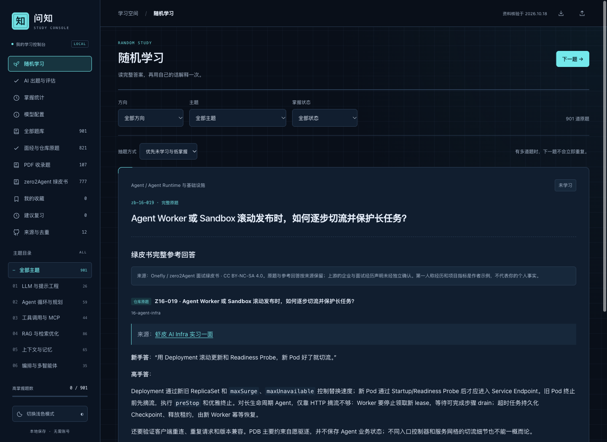
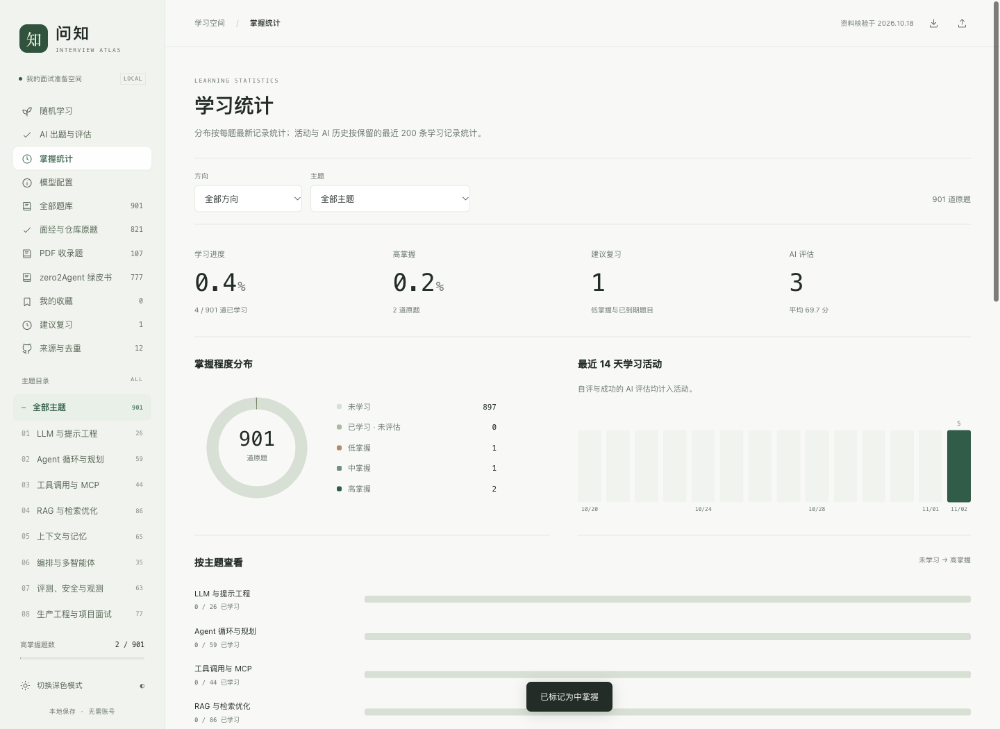

# Wenzhi · 问知

按主题复习 **Agent 开发与 Go 后端面试题**的本地网页。题目有出处，回答保留原理、取舍、追问、代码和案例；支持全文搜索、收藏和掌握状态。

当前题库 **901 道去重题，23 个主题**：Agent 827 道，Go 74 道。题库资料核验于 2026-10-18。



## 界面与交互

界面采用克制的学习控制台风格，支持深蓝/青色深色主题和冷白浅色主题。新用户默认深色，已有主题选择继续保留。换题过渡、输入焦点、模型等待与图表悬停提供轻量反馈；顶部细线表示当前页面的阅读位置，不代表学习成绩。系统设置“减少动画”时停用位移和旋转效果。原题、学习记录和模型调用方式不因界面调整改变。

## 启动

需要 Git、Python 3.9+ 和 make（macOS 开发工具已包含）。在终端执行：

```bash
git clone https://github.com/yz1qaq/Wenzhi.git
cd Wenzhi
make run
```

浏览器打开 **http://127.0.0.1:8765/**。`make`、`make run`、`make start`、`make ai` 启动的是同一个完整服务，同时提供网页和AI练习接口，均在前台运行。使用时保持终端开启；按 `Ctrl+C` 停止，再执行 `make run` 即可重启。

```bash
make run PORT=8766  # 端口占用时换端口，并打开对应地址
make help           # 查看命令说明
make test           # Python + JS测试，JS测试需Node.js
```

进入网页 **AI答题评估** 即可随机抽取题库原题；提交评分前，再到 **模型配置** 填写Base URL、API Key和model。启动服务本身不调用模型，也不会加载本机模型权重；模型由你配置的兼容服务提供。

macOS 可双击 `启动学习服务.command` 启动完整学习服务。若原来运行的是 `python3 -m http.server`，请先在原终端按 `Ctrl+C`，再改用上面的命令。端口占用时可用 `make run PORT=8766`，并访问对应端口。

直接打开 `index.html` 或双击 `打开题库.command` 仍可浏览题库、随机学习与查看统计；AI 练习须通过 `make run`（内部运行 `server.py`）启动。无需 npm 或额外 Python 包。只有 AI 评分需要你自己的模型服务配置；抽题不需要。

## 学习与掌握功能（2026-11-02）



- **随机学习**：按方向、主题、掌握状态抽取一道原题，直接显示完整答案。可均匀随机，或优先未学习/低掌握；连续两题不会立即重复（仅一道候选题时除外）。读后可标记已学习，或自评低/中/高。
- **AI 答题评估**：从现有题库随机抽取1/3/5道原题，题目标题保持原文，不调用AI生成或改写问题，也不需要配置Key。你独立输入回答后再提交评分。服务端将该题完整参考答案、绿皮书所有来源版本、相关原理/代码/追问提供给评估模型，显示分项得分、优点、遗漏、改进建议和原题完整答案，并更新该原题的掌握等级。只有提交评分才调用模型。
- **掌握统计**：学习率、高掌握率、建议复习数、AI评估均分、五状态分布、主题堆叠图、14天活动和近期AI历史。分布按每题最新记录；活动/历史最多保留最近200条，以限制浏览器存储大小。历史文本会保留有长度上限的摘录；当前评分页面展示完整模型反馈和参考答案。

学习与掌握分开记录：`未学习`、`已学习但未评估`、`低`、`中`、`高`。低掌握优先复习；中掌握3天、高掌握7天后进入建议复习。手动自评不产生虚构数字分数；模型评分由正确性40、完整性30、推理与边界20、表达10相加，低于60为低，60–84为中，85–100为高。严重核心误解最多59分。一次原题回答只代表一次观察，可通过后续自评或练习更新。

旧进度自动迁移：原“学习中”变为已学习未评估，“待复习”变为低，“已掌握”变为高；这些记录标为旧记录迁移，旧高掌握会进入一次复查。原始version1记录单独备份，无法读取的旧数据不会被静默覆盖。导入兼容version1和version2，旧别名与收藏继续生效。请在同一浏览器、同一访问地址（含端口）使用；跨地址需导出/导入。

### 模型配置与提示词

在网页“模型配置”填写API Base URL、API Key和model，使用 **OpenAI Chat Completions兼容协议**。支持服务根地址、`/v1`等路径或完整`/chat/completions`地址；远程地址须HTTPS，本机localhost/127.0.0.1可HTTP。无需鉴权的本机兼容服务可填写一个占位Key，如 `local`。不直接支持Anthropic原生Messages协议。

服务地址和model可存浏览器；**API Key仅保留当前页面内存**，刷新后重新填写，不进入学习记录、导出、仓库或服务日志。保存配置不调用模型；仅点击“提交评分”时才会向配置的服务商发送当前原题资料与回答，可能产生API费用。


- [评分提示词](prompts/grade.md)：针对原题与完整题库答案评分，认可等价答案、约束评分锚点和核心错误上限，忽略学生回答中的评分指令，给出具体反馈。
- [功能与记录规则](docs/superpowers/specs/2026-11-02-learning-design.md)。

修改提示词后重启服务生效。后端使用严格JSON校验，不把返回JSON等同于正确评分；无效输出、拒答、截断、网络错误不写入掌握记录。相同练习与相同答案成功后的重试返回缓存结果，避免重复评分；任务在服务重启或24小时后失效，遇到过期提示需重新抽题，浏览器中的既有学习记录仍保留。

### 检查

```bash
node --test tests/study-core.test.cjs
python3 -m unittest discover -s tests -v
```

测试使用本机模拟模型，不调用真实付费服务。网页源码为原生JS；Node只在运行JS单元测试时需要，使用网页不需要Node。

## 题库内容

| 方向 | 数量 | 主题示例 |
| --- | ---: | --- |
| Agent | 827 | Agent 循环与规划、工具与 MCP、RAG、记忆、评测、权限与恢复、多智能体、Prompt/Skills、训练、代码 Agent、Agent Runtime、AI Infra |
| Go | 74 | 类型与接口、Slice/Map、Channel、同步与 Context、调度与 GC、HTTP/RPC、数据库与分布式、手写与调试 |

来源包括开源仓库、公开面经、参考 PDF 和明确标记的整理补充。来源标签可以重叠，不能简单相加为总题数。

新增的 [zero2Agent](https://github.com/ranxi2001/zero2Agent) 绿皮书原称《Agent 面试 500 问》，本仓库固定使用《Agent 面试 800 问》v1.3.0（2026-10-14）：实际 828 道来源题、732 页 PDF。仓库 Markdown 与同版本 PDF 为同源内容，只计一次。

- 本轮：原 182 题 + 绿皮书 828 条 → 901 个主条目，合并 109 条，新增 719 个主条目。
- 累计：旧题 128 + 参考 PDF 116 + 绿皮书 828 = 1072 条输入 → 901 个主条目，累计合并 171 条。
- 绿皮书 828 道来源题关联 777 个主题；完整保留高手答，其中 827 道另有新手答对照，1 道为笔试代码题。
- 去重按问题目标和答题范围判断。原题问法、完整回答和固定版本链接保留，独立子问题继续分开。

[查看完整去重对照](去重对照表.md) · [完整详细题库 Markdown](题库汇总.md) · [来源与筛选](来源与筛选.md)

## 使用

- 从“全部题库”“面经与仓库原题”“PDF 收录题”“zero2Agent 绿皮书”选择题集。
- 按主题、方向、来源、难度和掌握状态筛选；搜索覆盖题干、完整回答、原题号与来源。
- 新题直接显示完整来源回答；合并到旧题的绿皮书答案在“绿皮书原题与完整参考回答”中展开。
- 支持收藏、未学习/已学习未评估/低中高掌握、随机学习、深色模式及手机布局。按 `/` 聚焦搜索。
- 学习进度保存在当前浏览器本地。顶栏按钮可导入、导出进度；更换浏览器、访问地址或清理本地数据前请先导出。

## 维护

```text
index.html / app.js / styles.css  网页源码
data.json                        权威题库数据
data.js                          离线网页数据
sync-data.py                     同步数据与 Markdown
materials/                       原始参考材料、署名和许可
examples/                        Go 练习与测试
```

修改 `data.json` 后运行：

```bash
python3 sync-data.py
```

它会更新 `data.js`、`题库汇总.md` 和 `去重对照表.md`。更改题目时保留旧 ID 和别名映射，避免破坏已有学习进度。当前同步脚本适用于本版数据结构。

独立 Go 练习可运行：

```bash
cd examples
go test -race ./...
```

[详细使用说明](使用说明.md) · [实际验证记录](验证说明.md) · [结构化核验记录](核验记录.json)

## 来源与许可

本仓库包含不同来源的内容，**不适用统一的 MIT 许可**。

- zero2Agent 绿皮书作者 **Onefly**，内容采用 **CC BY-NC-SA 4.0**。本地分类、合并与标明的技术校注为整理改动。转载这些内容及改编时须保留署名、注明改动、限非商业使用，并按相同许可分享，详见[完整署名与许可说明](materials/zero2Agent/NOTICE.md)。上游仓库代码的 MIT 许可不替代绿皮书内容的许可。
- 其他仓库资料、参考文档与本仓库原创内容按各自权利和明确声明处理；未标明开放许可的材料，不因收录而自动获得额外授权。详见[第三方内容说明](THIRD_PARTY_NOTICES.md)。

“仓库原题”表示出处可定位。企业、轮次和频次是原作者整理或个人回忆，未由企业独立确认；参考回答不代表企业统一唯一答案。第一人称案例和性能指标属于原作者示例，不是使用者个人经历。部分技术表述已添加带出处的校注，未逐项验证全书全部断言。
