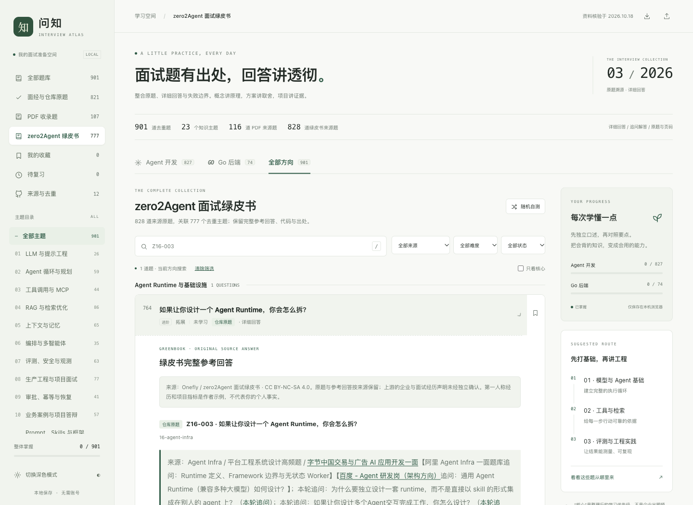

# Wenzhi · 问知

按主题复习 **Agent 开发与 Go 后端面试题**的本地网页。题目有出处，回答保留原理、取舍、追问、代码和案例；支持全文搜索、收藏和复习状态。

当前题库 **901 道去重题，23 个主题**：Agent 827 道，Go 74 道。题库资料核验于 2026-10-18。



## 启动

先安装 Git 和 Python 3，在终端执行：

```bash
git clone https://github.com/yz1qaq/Wenzhi.git
cd Wenzhi
python3 -m http.server 8765 --bind 127.0.0.1
```

浏览器打开 **http://127.0.0.1:8765/**。使用时保持终端运行，按 `Ctrl+C` 停止服务。

也可以直接打开 `index.html`；macOS 可双击 `打开题库.command`。网页数据、样式和脚本都在本地，无需 npm、账号或模型 API 密钥。访问 GitHub 和面经原帖时才需要联网。

## 题库内容

| 方向 | 数量 | 主题示例 |
| --- | ---: | --- |
| Agent | 827 | Agent 循环与规划、工具与 MCP、RAG、记忆、评测、权限与恢复、多智能体、Prompt/Skills、训练、代码 Agent、Agent Runtime、AI Infra |
| Go | 74 | 类型与接口、Slice/Map、Channel、同步与 Context、调度与 GC、HTTP/RPC、数据库与分布式、手写与调试 |

来源包括开源仓库、公开面经、参考 PDF 和明确标记的整理补充。来源标签可以重叠，不能简单相加为总题数。

新增的 [zero2Agent](https://github.com/ranxi2001/zero2Agent) 绿皮书原称《Agent 面试 500 问》，本仓库固定使用《Agent 面试 800 问》v1.3.0（2026-10-14）：实际 828 道来源题、732 页 PDF。仓库 Markdown 与同版本 PDF 为同源内容，只计一次。

- 本轮：原 182 题 + 绿皮书 828 条 → 901 个主条目，合并 109 条，新增 719 个主条目。
- 累计：旧题 128 + 参考 PDF 116 + 绿皮书 828 = 1072 条输入 → 901 个主条目，累计合并 171 条。
- 绿皮书 828 道来源题关联 777 个主题；完整保留高手答，其中 827 道另有新手答对照，1 道为笔试代码题。
- 去重按问题目标和答题范围判断。原题问法、完整回答和固定版本链接保留，独立子问题继续分开。

[查看完整去重对照](去重对照表.md) · [完整详细题库 Markdown](题库汇总.md) · [来源与筛选](来源与筛选.md)

## 使用

- 从“全部题库”“面经与仓库原题”“PDF 收录题”“zero2Agent 绿皮书”选择题集。
- 按主题、方向、来源、难度和复习状态筛选；搜索覆盖题干、完整回答、原题号与来源。
- 新题直接显示完整来源回答；合并到旧题的绿皮书答案在“绿皮书原题与完整参考回答”中展开。
- 支持收藏、未学习/学习中/待复习/已掌握、随机自测、深色模式及手机布局。按 `/` 聚焦搜索。
- 学习进度保存在当前浏览器本地。顶栏按钮可导入、导出进度；更换浏览器、访问地址或清理本地数据前请先导出。

## 维护

```text
index.html / app.js / styles.css  网页源码
data.json                        权威题库数据
data.js                          离线网页数据
sync-data.py                     同步数据与 Markdown
materials/                       原始参考材料、署名和许可
examples/                        Go 练习与测试
```

修改 `data.json` 后运行：

```bash
python3 sync-data.py
```

它会更新 `data.js`、`题库汇总.md` 和 `去重对照表.md`。更改题目时保留旧 ID 和别名映射，避免破坏已有学习进度。当前同步脚本适用于本版数据结构。

独立 Go 练习可运行：

```bash
cd examples
go test -race ./...
```

[详细使用说明](使用说明.md) · [实际验证记录](验证说明.md) · [结构化核验记录](核验记录.json)

## 来源与许可

本仓库包含不同来源的内容，**不适用统一的 MIT 许可**。

- zero2Agent 绿皮书作者 **Onefly**，内容采用 **CC BY-NC-SA 4.0**。本地分类、合并与标明的技术校注为整理改动。转载这些内容及改编时须保留署名、注明改动、限非商业使用，并按相同许可分享，详见[完整署名与许可说明](materials/zero2Agent/NOTICE.md)。上游仓库代码的 MIT 许可不替代绿皮书内容的许可。
- 其他仓库资料、参考文档与本仓库原创内容按各自权利和明确声明处理；未标明开放许可的材料，不因收录而自动获得额外授权。详见[第三方内容说明](THIRD_PARTY_NOTICES.md)。

“仓库原题”表示出处可定位。企业、轮次和频次是原作者整理或个人回忆，未由企业独立确认；参考回答不代表企业统一唯一答案。第一人称案例和性能指标属于原作者示例，不是使用者个人经历。部分技术表述已添加带出处的校注，未逐项验证全书全部断言。
